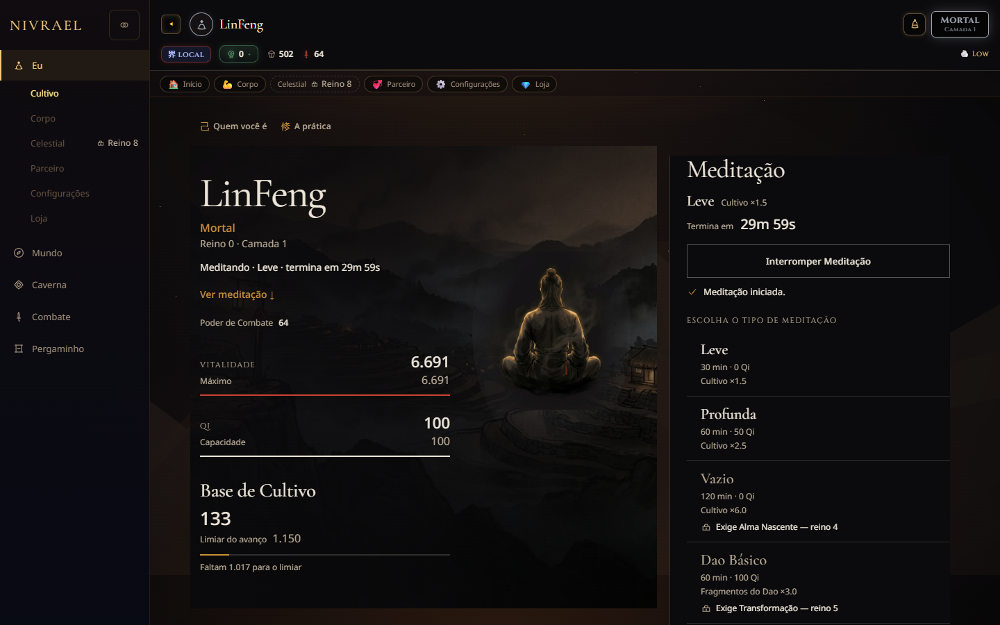
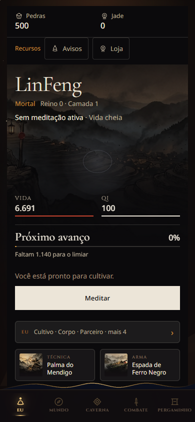
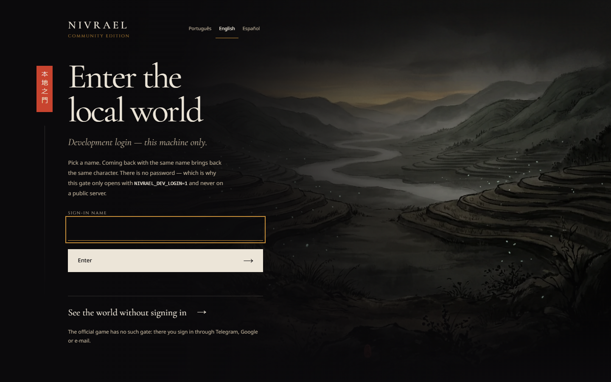

# Nivrael — community edition

*A Wuxia / Xianxia cultivation RPG that keeps moving after you close the tab.*

You meditate to gather Qi, break through eleven<!--#realms--> realms from Mortal to True
Immortal, temper the body, refine pills and forge artifacts, raise spirit
beasts, join a sect, clear dungeons floor by floor, duel in the arena and live
in a world whose houses, cities and skies change on their own. It plays in the
browser and as a Telegram Mini App, in Portuguese (Brazil), English and Spanish.

This repository is the **community edition** of the official game: the same
engines, the same client and the same 140+<!--#migrations--> migrations, with every private thing
taken out and a few differences (listed below) so that anyone can run it, study
it and improve it.

> *The path to immortality belongs to everyone.*

<p align="center">
  <br>
  
  
</p>

---

## Play it on your machine

### With Docker (nothing else to install)

```bash
docker compose up
```

Open **http://localhost:8080/login**, choose a sign-in name, then choose your
cultivator's name. That's it.

The first boot is the slow one: it creates two game worlds, runs every migration
and seeds the catalogues (techniques, pills, beasts, dungeons, sects…). New
players are born in the **local world**, which has all of today's features
turned on. Data lives in Docker volumes and survives restarts.

### Without Docker

You need Python 3.11+<!--#python-->, PostgreSQL 17<!--#postgres--> and, to build the client, Node 20+<!--#node-->.

```bash
pip install -r requirements.txt
cp .env.example .env              # then point DATABASE_URL at your Postgres
NIVRAEL_DEV_LOGIN=1 python -m community.local
```

The Postgres role needs `CREATEDB` (each world is its own database).
The game works without the build step — the client then compiles itself in
the browser, slowly. To serve what players get, build the client and the site
once:

```bash
cd website && npm ci && npm run build && cd ..
node scripts/build_miniapp.mjs miniapp
```

### With your own Telegram bot

`python main.py` runs the chat bot and the Mini App with `BOT_TOKEN` from
[@BotFather](https://t.me/BotFather). Everything else in `.env.example` applies.

---

## What is different from the official game

| | official game | this edition |
|---|---|---|
| Real-money purchases (Telegram Stars) | on | **off** — `NIVRAEL_MONETIZATION=0` |
| Gacha | on | **off** — the shop explains why |
| Sign-in | Telegram, Google, Apple, e-mail | your own Firebase project, Telegram, or the **local development login** (`NIVRAEL_DEV_LOGIN=1`, name only, never on a public server) |
| Worlds | Legacy + the current world | `main` + a **local world** with all 40<!--#flags--> feature flags on |
| Legal pages (`/privacy`, `/terms`) | the official game's | the same text as a template — rewrite it for your instance |
| Player names in comments and old release notes | the reporters' names | replaced by `[jogador]` |
| A few notes on the story still to come | in comments of the official code | kept out — they change nothing a player sees |

`NIVRAEL_MONETIZATION=1` restores the official behaviour. Stars only pay the
owner of the bot that issues them, and the gacha is regulated differently in
different countries: if you run a public instance, those decisions are yours.

## Project status

**The official game is live and actively developed.** Its creator hosts it and
pays for its server. If it ever has to close, its players will be told at least
**30 days** ahead — and this repository stays: the game never disappears.

This edition and the official game share one code base. Anything merged here can
reach the official game, but only its owner decides what goes to its servers,
and when — see [MAINTAINERS.md](MAINTAINERS.md).

## Project layout

```
core/          the engines — cultivation, combat, sects, dungeons, the living world…
               core/cultivator_soul.py is the single source of power, stats and HP
handlers/      the Telegram chat surface
database/      models, the per-world router and the content seeds
migrations/    SQL, applied in order on every world at boot (only ever additive)
miniapp/       the client (React, compiled by scripts/build_miniapp.mjs) and its 3 languages
locales/       the chat's 3 languages
website/       the landing site (Vite + React + Tailwind)
community/     what only this edition has: the local runner, the local world, the dev login
scripts/       the test suites, the audits, the sabotage batteries, the dev harness
```

## Tests and guards

```bash
python scripts/run_tests.py
```

runs everything: the **30<!--#game_suites--> game suites** (no database needed), the
community edition suite, the audits (Python 3.11<!--#python--> syntax, ORM columns), the
**documentation guard** — `scripts/_verifica_documentacao.py`, which checks every
page against the code — and the **publication guard** —
`scripts/_verifica_copia_publica.py`, which refuses secrets, player data, IP
addresses, private folders and altered licence texts. The guards are proven by
sabotage (`scripts/_sabota_*.py` break the code on purpose and check that the
guard turns red). The continuous integration runs the same command on every pull
request ([`.github/workflows/ci.yml`](.github/workflows/ci.yml)).

## Documentation

[`docs/`](docs/README.md) explains how the game is built — the installation, the
architecture, the database, the translations, and one page per system — written
from the code, and checked against it on every pull request.

`python scripts/_dev_serve_miniapp.py` serves the client with staged data, no
database, for looking at a screen at 390×844 and 1440×900.

## Contributing

Read [CONTRIBUTING.md](CONTRIBUTING.md) — small pull requests with a test, the
three languages kept in parity, migrations that only add, and every commit
signed off (DCO). Who reviews and who decides is in
[MAINTAINERS.md](MAINTAINERS.md). By participating you agree to the
[Code of Conduct](CODE_OF_CONDUCT.md). Security problems go to
[SECURITY.md](SECURITY.md), never to a public issue.

## License

- **Code:** [GNU AGPL-3.0-only](LICENSE). If you run a modified version as a
  server, you must offer its source to its users.
- **Art and game text** (images, the language catalogues): [CC BY-NC-SA 4.0](LICENSE-ASSETS).
- Exactly which files are which: [NOTICE.md](NOTICE.md).
- **The name "Nivrael" and its logo are reserved** for the official game — a
  fork must use its own name. See [TRADEMARKS.md](TRADEMARKS.md).

---

<details>
<summary><b>Português (Brasil)</b></summary>

**Nivrael** é um RPG de cultivo Wuxia/Xianxia que continua andando depois que
você fecha a aba: medite, avance pelos onze<!--#realms--> reinos, refine pílulas, forje
artefatos, crie bestas espirituais, entre numa seita, desça masmorras e viva num
mundo que muda sozinho. Este repositório é a **edição comunitária** do jogo
oficial — os mesmos motores e o mesmo cliente, sem nada privado.

**Jogar em casa:** `docker compose up` e abra **http://localhost:8080/login**.
Sem Docker: Python 3.11+<!--#python-->, PostgreSQL 17<!--#postgres-->, `pip install -r requirements.txt`,
`cp .env.example .env` e `NIVRAEL_DEV_LOGIN=1 python -m community.local`.

**Diferenças:** compras reais e gacha vêm desligados (`NIVRAEL_MONETIZATION=0`);
o login local de desenvolvimento entra só com um nome e nunca deve ir para um
servidor público; o mundo local nasce com as 40<!--#flags--> flags do jogo de hoje.

**Estado do projeto:** o jogo oficial está no ar e em desenvolvimento ativo; o
criador hospeda e paga o servidor. Se um dia tiver de fechar, os jogadores
sabem com pelo menos **30 dias** de antecedência — e este repositório fica: o
jogo nunca desaparece. Só o dono do jogo oficial decide o que vai para os
servidores dele (ver `MAINTAINERS.md`).

**Licenças:** código AGPL-3.0-only; arte e texto CC BY-NC-SA 4.0; o nome
"Nivrael" é reservado ao jogo oficial (ver `TRADEMARKS.md`). Para contribuir,
leia o `CONTRIBUTING.md`.

</details>

<details>
<summary><b>Español</b></summary>

**Nivrael** es un RPG de cultivo Wuxia/Xianxia que sigue avanzando cuando
cierras la pestaña: medita, asciende por once<!--#realms--> reinos, refina píldoras, forja
artefactos, cría bestias espirituales, únete a una secta, baja mazmorras y vive
en un mundo que cambia solo. Este repositorio es la **edición comunitaria** del
juego oficial — los mismos motores y el mismo cliente, sin nada privado.

**Jugar en casa:** `docker compose up` y abre **http://localhost:8080/login**.
Sin Docker: Python 3.11+<!--#python-->, PostgreSQL 17<!--#postgres-->, `pip install -r requirements.txt`,
`cp .env.example .env` y `NIVRAEL_DEV_LOGIN=1 python -m community.local`.

**Diferencias:** las compras reales y el gacha vienen desactivados
(`NIVRAEL_MONETIZATION=0`); el inicio de sesión local entra solo con un nombre y
nunca debe ir a un servidor público; el mundo local nace con las 40<!--#flags--> flags del
juego actual.

**Estado del proyecto:** el juego oficial está en línea y en desarrollo activo;
su creador lo aloja y paga el servidor. Si algún día tiene que cerrar, sus
jugadores lo sabrán con al menos **30 días** de antelación — y este repositorio
se queda: el juego nunca desaparece. Solo el dueño del juego oficial decide qué
llega a sus servidores (ver `MAINTAINERS.md`).

**Licencias:** código AGPL-3.0-only; arte y texto CC BY-NC-SA 4.0; el nombre
"Nivrael" está reservado al juego oficial (ver `TRADEMARKS.md`). Para
contribuir, lee `CONTRIBUTING.md`.

</details>
