# Nivrael Landing Page — Architecture & Design Document

> **Scope**: Design-only document. No code changes — only architecture decisions, wireframes, and implementation specs.
>
> **Date**: 2026-03-12 | **Status**: Draft for Review

---

## Table of Contents

1. [Design Principles](#1-design-principles)
2. [Wireframe](#2-wireframe)
3. [Component Architecture](#3-component-architecture)
4. [Performance Budget](#4-performance-budget)
5. [CTA Strategy](#5-cta-strategy)
6. [Accessibility Plan](#6-accessibility-plan)
7. [Implementation Order](#7-implementation-order)
8. [CSS Animation Specs](#8-css-animation-specs)

---

## 1. Design Principles

### P1 — Performance Is the Feature
Every millisecond of load time is a lost cultivator. Target LCP < 2.0s, TTI < 3.0s. Zero Three.js, zero artificial loading delays. CSS/SVG animations only in the hero. Budget every animation frame.

### P2 — Mobile-First Immersion
The hero "world entry" must feel magical on a 375px screen with 4G. Progressive enhancement adds desktop flourishes — never the other way around. Touch targets ≥ 44px. Reduced-motion users get a beautiful static experience.

### P3 — CTA Gravity
The Telegram Bot link is the singular conversion goal. Every scroll depth must have a clear, non-obstructive path to the Bot CTA. Group/community links are secondary — they exist to build trust, not compete for attention.

### P4 — Cultivation Aesthetic Through Restraint
The Wuxia/Xianxia mood comes from color, typography, and negative space — not from particle count. Gold (#FFD700) on deep void backgrounds, Chinese calligraphy as texture, mountain silhouettes as shape language. Fewer elements, more presence.

### P5 — Semantic & Accessible by Default
Proper HTML landmarks, keyboard navigation, ARIA labels, and color-contrast compliance are non-negotiable baseline. Accessibility is not a separate phase — it ships with every component.

---

## 2. Wireframe

### 2.1 Full Page Layout — Text-Based Wireframe

```
┌─────────────────────────────────────────────────────────────────────┐
│  [Skip to Content]  (visually hidden, keyboard-focusable)          │
├─────────────────────────────────────────────────────────────────────┤
│  <header> NAVBAR (fixed top, z-50)                                 │
│  ┌───────────────────────────────────────────────────────────────┐  │
│  │  NIVRAEL    Features  Realms  Community  Feedback   [⚔ CTA]  │  │
│  │  (logo)     (nav links — desktop only)         (Language)     │  │
│  └───────────────────────────────────────────────────────────────┘  │
├─────────────────────────────────────────────────────────────────────┤
│  <main id="main-content">                                          │
│                                                                     │
│  ┌─── HERO SECTION ─────────────────────────────────────────────┐  │
│  │                                                               │  │
│  │         ~~~~~ mist layer (CSS blur + gradient) ~~~~~          │  │
│  │                                                               │  │
│  │      ▲    ╱▲╲       SVG mountain silhouettes                  │  │
│  │     ╱ ╲  ╱  ╲  ▲   (3-4 layers, parallax transforms)         │  │
│  │    ╱   ╲╱    ╲╱ ╲                                             │  │
│  │   ╱              ╲                                            │  │
│  │                                                               │  │
│  │            ◯  Dao Circle (SVG, CSS spin)                      │  │
│  │           ╱ ╲                                                 │  │
│  │                                                               │  │
│  │        ·  ·    · ·  CSS-only particles (max 24)               │  │
│  │      ·        ·                                               │  │
│  │                                                               │  │
│  │              道途：永生之路                                      │  │
│  │                                                               │  │
│  │               NIVRAEL                                          │  │
│  │           Path of Immortals                                   │  │
│  │                                                               │  │
│  │     ┌─────────────────────────────────────┐                   │  │
│  │     │  "Narrative intro typing text..."   │  glass panel      │  │
│  │     │   Tagline description below         │                   │  │
│  │     └─────────────────────────────────────┘                   │  │
│  │                                                               │  │
│  │     [⚔️ Begin Your Cultivation]   [📖 Explore Realms]         │  │
│  │      (Primary CTA → Bot)           (Secondary → scroll)       │  │
│  │                                                               │  │
│  │              ╷ scroll indicator ╷                              │  │
│  └───────────────────────────────────────────────────────────────┘  │
│                                                                     │
│  ┌─── FEATURES SECTION (#features) ─────────────────────────────┐  │
│  │  Title + subtitle                                             │  │
│  │  ┌──────┐ ┌──────┐ ┌──────┐ ┌──────┐                        │  │
│  │  │ Card │ │ Card │ │ Card │ │ Card │  (8 feature cards)      │  │
│  │  └──────┘ └──────┘ └──────┘ └──────┘  2x4 grid desktop      │  │
│  │  ┌──────┐ ┌──────┐ ┌──────┐ ┌──────┐  1-col mobile          │  │
│  │  │ Card │ │ Card │ │ Card │ │ Card │                         │  │
│  │  └──────┘ └──────┘ └──────┘ └──────┘                         │  │
│  └───────────────────────────────────────────────────────────────┘  │
│                                                                     │
│  ┌─── GAME PREVIEW (#preview) ──────────────────────────────────┐  │
│  │  Telegram bot mockup UI                                       │  │
│  │  ┌─────────────────────────┐                                  │  │
│  │  │  [Bot conversation]     │                                  │  │
│  │  │  [Bot conversation]     │                                  │  │
│  │  └─────────────────────────┘                                  │  │
│  └───────────────────────────────────────────────────────────────┘  │
│                                                                     │
│  ┌─── REALM TIMELINE (#realms) ─────────────────────────────────┐  │
│  │  Title                                                        │  │
│  │  ┌────┐ ┌────┐ ┌────┐ ┌────┐ ┌────┐ ┌────┐   (11 cards)    │  │
│  │  │ R1 │ │ R2 │ │ R3 │ │ R4 │ │ R5 │ │ R6 │   grid layout   │  │
│  │  └────┘ └────┘ └────┘ └────┘ └────┘ └────┘   lazy images    │  │
│  │  ┌────┐ ┌────┐ ┌────┐ ┌────┐ ┌────┐                         │  │
│  │  │ R7 │ │ R8 │ │ R9 │ │R10│ │R11│                           │  │
│  │  └────┘ └────┘ └────┘ └────┘ └────┘                         │  │
│  └───────────────────────────────────────────────────────────────┘  │
│                                                                     │
│  ┌─── COMMUNITY (#community) ───────────────────────────────────┐  │
│  │  Title + counter                                              │  │
│  │  ┌──────────┐ ┌──────────┐ ┌──────────┐                     │  │
│  │  │ Bot Card │ │ Channel  │ │ Group    │                      │  │
│  │  │ (primary)│ │ (second) │ │ (second) │                      │  │
│  │  └──────────┘ └──────────┘ └──────────┘                      │  │
│  └───────────────────────────────────────────────────────────────┘  │
│                                                                     │
│  ┌─── BETA FEEDBACK (#feedback) ────────────────────────────────┐  │
│  │  ┌────────┐ ┌────────┐ ┌────────┐                            │  │
│  │  │ Bug    │ │ Suggest│ │ Review │                             │  │
│  │  └────────┘ └────────┘ └────────┘                             │  │
│  └───────────────────────────────────────────────────────────────┘  │
│                                                                     │
│  </main>                                                            │
│                                                                     │
│  ┌─── <footer> ─────────────────────────────────────────────────┐  │
│  │  NIVRAEL branding | Links | Copyright                         │  │
│  │  CSS gradient decoration (no canvas particles)                │  │
│  └───────────────────────────────────────────────────────────────┘  │
│                                                                     │
│  ┌─── STICKY MOBILE CTA (mobile only, z-40) ───────────────────┐  │
│  │  [⚔️ Begin Your Cultivation →]   (fixed bottom bar)           │  │
│  │  Appears after scrolling past hero CTA                        │  │
│  └───────────────────────────────────────────────────────────────┘  │
│                                                                     │
│  ScrollProgress (desktop only, right edge) — UNCHANGED             │
└─────────────────────────────────────────────────────────────────────┘
```

### 2.2 Hero Section Detail — Layered Composition

```
Z-ORDER (back to front):

z-0   ┌─ Void background (CSS solid: hsl 240 70% 3%) ─────────────────┐
      │  Pure dark background, no image needed                         │
      └────────────────────────────────────────────────────────────────┘

z-1   ┌─ Star field (CSS radial-gradient dots) ────────────────────────┐
      │  background-image: radial-gradient(1px 1px at Xpx Ypx, ...)   │
      │  ~40-50 dots via multiple gradient stops                       │
      │  Subtle twinkle via opacity @keyframes (staggered delays)      │
      └────────────────────────────────────────────────────────────────┘

z-2   ┌─ Mountain Layer 3 — farthest (SVG inline) ────────────────────┐
      │  Darkest silhouette, largest, slowest parallax                 │
      │  transform: translateY(calc(var(--scroll) * 0.05))             │
      │  fill: hsl(240, 30%, 8%)                                      │
      └────────────────────────────────────────────────────────────────┘

z-3   ┌─ Mountain Layer 2 — mid (SVG inline) ─────────────────────────┐
      │  Medium silhouette, mid parallax                               │
      │  transform: translateY(calc(var(--scroll) * 0.12))             │
      │  fill: hsl(240, 35%, 6%)                                      │
      └────────────────────────────────────────────────────────────────┘

z-4   ┌─ Mist Layer (CSS) ────────────────────────────────────────────┐
      │  Translucent gradient divs with blur(30-60px)                  │
      │  Animated translateX drift (slow, 20-30s loop)                 │
      │  2-3 overlapping divs for depth                                │
      └────────────────────────────────────────────────────────────────┘

z-5   ┌─ Mountain Layer 1 — nearest (SVG inline) ─────────────────────┐
      │  Sharpest silhouette, fastest parallax                         │
      │  transform: translateY(calc(var(--scroll) * 0.2))              │
      │  fill: hsl(240, 40%, 4%)                                      │
      └────────────────────────────────────────────────────────────────┘

z-6   ┌─ Dao Circle (SVG) ────────────────────────────────────────────┐
      │  Two concentric rings + 8 radial lines                         │
      │  CSS rotation: animation: spin 60s linear infinite             │
      │  Gold glow via filter: drop-shadow                             │
      │  Positioned center, above mountains                            │
      └────────────────────────────────────────────────────────────────┘

z-7   ┌─ CSS Particles (~24 total) ───────────────────────────────────┐
      │  <div> elements with @keyframes float-up                       │
      │  Random sizes (2-5px), random delays, random x-positions       │
      │  Colors: gold, cyan, purple (matching existing palette)        │
      │  will-change: transform, opacity                               │
      └────────────────────────────────────────────────────────────────┘

z-8   ┌─ Radial Vignette (CSS gradient overlay) ──────────────────────┐
      │  radial-gradient(ellipse at center, transparent 25%,           │
      │    rgba(3,3,8,0.72) 70%, rgba(3,3,8,0.96) 100%)              │
      └────────────────────────────────────────────────────────────────┘

z-9   ┌─ Calligraphy Watermarks (CSS text, unchanged) ────────────────┐
      │  乾坤 and 天道 vertical text, low opacity                       │
      └────────────────────────────────────────────────────────────────┘

z-10  ┌─ Text Content + CTAs ─────────────────────────────────────────┐
      │  Badge → Chinese subtitle → NIVRAEL title → subtitle →        │
      │  Narrative panel → CTAs                                        │
      │  CSS-only entrance: @keyframes fade-slide-up with stagger      │
      │  No GSAP dependency for hero text entrance                     │
      └────────────────────────────────────────────────────────────────┘

z-20  ┌─ Bottom depth fade (CSS gradient) ────────────────────────────┐
      │  gradient-to-top from void-deep                                │
      └────────────────────────────────────────────────────────────────┘
```

### 2.3 Mobile Hero Layout

```
┌─────────────────────────┐
│      (Navbar 48px)      │
├─────────────────────────┤
│                         │
│  Mountains (2 layers    │
│  only, reduced detail)  │
│                         │
│       ◯ Dao Circle      │
│      (smaller, 120px)   │
│                         │
│   · · CSS particles · · │
│    (max 12 on mobile)   │
│                         │
│  ┌───────────────────┐  │
│  │   [BETA BADGE]    │  │
│  │   道途：永生之路     │  │
│  │    NIVRAEL         │  │
│  │ Path of Immortals  │  │
│  │                    │  │
│  │ "Narrative text.." │  │
│  │  Tagline below     │  │
│  │                    │  │
│  │ [Begin Cultivation]│  │
│  │ [Explore Realms]   │  │
│  └───────────────────┘  │
│                         │
│       ╷ scroll ╷        │
├─────────────────────────┤
│  ... rest of page ...   │
│                         │
├─────────────────────────┤
│ [⚔️ Begin Cultivation →]│ ← Sticky CTA bar
└─────────────────────────┘    (appears after hero)
```

---

## 3. Component Architecture

### 3.1 Component Disposition Table

| Current Component | Disposition | Rationale |
|---|---|---|
| [`HeroScene.tsx`](src/components/HeroScene.tsx:1) | **DELETE** | Three.js is the biggest perf bottleneck. Replace entirely with CSS/SVG in new `OptimizedHero`. |
| [`HeroSection.tsx`](src/components/HeroSection.tsx:1) | **REPLACE** → `OptimizedHero` | Remove GSAP, Framer Motion scroll transforms. Use CSS-only animations + a single scroll listener. |
| [`LoadingScreen.tsx`](src/components/LoadingScreen.tsx:1) | **DELETE** | Artificial delay. Replace with instant render + progressive reveal. |
| [`CustomCursor.tsx`](src/components/CustomCursor.tsx:1) | **REFACTOR** | Replace canvas RAF loop with CSS-only cursor. Use `cursor: url(...)` or CSS `::after` pseudo-element trail. Eliminates 1 full-time RAF loop. |
| [`Footer.tsx`](src/components/Footer.tsx:1) | **REFACTOR** | Remove canvas particle system. Replace with CSS gradient decorations matching the existing aesthetic. |
| [`MagneticButton.tsx`](src/components/MagneticButton.tsx:1) | **REFACTOR** | Add debounced/throttled mousemove. Add `prefers-reduced-motion` check to skip effect entirely. |
| [`Navbar.tsx`](src/components/Navbar.tsx:1) | **REFACTOR** | Add `<nav aria-label>`, keyboard focus ring styles, proper `role` on mobile toggle. Remove JS-driven CTA pulse — replace with CSS `@keyframes`. |
| [`FeaturesSection.tsx`](src/components/FeaturesSection.tsx:1) | **REFACTOR** | Replace canvas particle burst with CSS `@keyframes` radial burst. Swap GSAP ScrollTrigger for `IntersectionObserver`. |
| [`GamePreview.tsx`](src/components/GamePreview.tsx:1) | **KEEP** (minor) | Add lazy loading for images if any. Minor accessibility pass. |
| [`RealmTimeline.tsx`](src/components/RealmTimeline.tsx:1) | **REFACTOR** | Replace GSAP ScrollTrigger with IntersectionObserver. Add keyboard navigation for flip cards. Lazy load all 11 realm images with `LazyImage`. |
| [`CommunitySection.tsx`](src/components/CommunitySection.tsx:1) | **REFACTOR** | Fix community link URLs (see CTA section). Minor a11y pass. |
| [`BetaFeedbackSection.tsx`](src/components/BetaFeedbackSection.tsx:1) | **KEEP** (minor) | No major issues. Minor a11y pass. |
| [`Index.tsx`](src/pages/Index.tsx:1) | **REFACTOR** | Add semantic HTML, remove Lenis, add IntersectionObserver context. |

### 3.2 New Components

#### `OptimizedHero` — replaces `HeroSection` + `HeroScene`

| Aspect | Detail |
|---|---|
| **File** | `src/components/OptimizedHero.tsx` |
| **Responsibility** | Immersive hero "world entry" with CSS/SVG-only visuals |
| **Layers** | SVG mountain silhouettes (3 layers), CSS mist, SVG Dao circle, CSS particles, text content |
| **Parallax** | Single `scroll` event listener sets a CSS custom property `--scroll-y`. Mountain layers use `transform: translateY(calc(var(--scroll-y) * FACTOR))`. No RAF needed — browser handles transform compositing. |
| **Particles** | 24 `<div>` elements positioned with CSS `@keyframes float-particle-N`. DOM elements with `will-change: transform`. Gender into component via a loop. |
| **Text entrance** | Pure CSS `@keyframes fade-slide-up` with `animation-delay` on each `.hero-text-item` child. No GSAP. |
| **Typing effect** | Keep the `setInterval`-based typing for narrative intro (lightweight, minimal). |
| **Dependencies** | React, `useLanguage` hook only. Zero external animation libraries. |
| **Reduced motion** | If `prefers-reduced-motion: reduce`, show all elements instantly in final position. No parallax, no particles, no typing — display full text. |

#### `StickyMobileCTA` — new

| Aspect | Detail |
|---|---|
| **File** | `src/components/StickyMobileCTA.tsx` |
| **Responsibility** | Fixed bottom CTA bar on mobile, appears when hero CTA scrolls out of view |
| **Visibility** | Uses `IntersectionObserver` on the hero CTA button. Once hero CTA is not intersecting, this bar slides up from bottom. |
| **Content** | Single primary CTA: "⚔️ Begin Your Cultivation →" linking to `https://t.me/Nivrael_bot` |
| **Style** | Full-width bar, gold gradient background, height 56px, safe-area-inset-bottom padding |
| **Desktop** | Hidden via `md:hidden`. Desktop has navbar CTA always visible. |
| **Z-index** | `z-40` — below navbar (z-50) but above content |

#### `LazyImage` — new

| Aspect | Detail |
|---|---|
| **File** | `src/components/LazyImage.tsx` |
| **Responsibility** | Progressive image loading with blur-up placeholder |
| **Props** | `src`, `alt`, `width`, `height`, `srcSet?`, `sizes?`, `className?` |
| **Behavior** | - Renders a `<div>` with background color matching image dominant tone<br>- Uses `loading="lazy"` + `decoding="async"` on ``<br>- CSS transition from blur placeholder to sharp image on load<br>- Supports WebP `srcSet` with PNG fallback |
| **IntersectionObserver** | Optional eager loading for above-fold images. All below-fold images use native lazy. |

#### `useIntersectionObserver` — new hook

| Aspect | Detail |
|---|---|
| **File** | `src/hooks/useIntersectionObserver.ts` |
| **Responsibility** | Reusable IO hook for visibility-triggered animations/actions |
| **API** | `useIntersectionObserver(ref, options?) → { isIntersecting, entry }` |
| **Usage** | Replace all GSAP ScrollTrigger instances, replace manual IO setup in `CommunitySection`, drive `StickyMobileCTA` visibility |

#### `useReducedMotion` — new hook

| Aspect | Detail |
|---|---|
| **File** | `src/hooks/useReducedMotion.ts` |
| **Responsibility** | Detects `prefers-reduced-motion: reduce` media query |
| **API** | `useReducedMotion() → boolean` |
| **Usage** | Components conditionally skip animations. Works alongside CSS `@media (prefers-reduced-motion)`. |

### 3.3 Restructured `Index.tsx` Semantic Layout

```tsx
// Pseudocode for new Index.tsx structure
<>
  <a href="#main-content" className="skip-link">Skip to content</a>
  
  <header>
    <Navbar />
  </header>
  
  <ScrollProgress />  {/* aria-hidden, decorative only */}
  
  <main id="main-content">
    <OptimizedHero />
    
    <Suspense fallback={<SectionSkeleton />}>
      <FeaturesSection />
    </Suspense>
    
    <Suspense fallback={<SectionSkeleton />}>
      <GamePreview />
    </Suspense>
    
    <Suspense fallback={<SectionSkeleton />}>
      <RealmTimeline />
    </Suspense>
    
    <Suspense fallback={<SectionSkeleton />}>
      <CommunitySection />
    </Suspense>
    
    <Suspense fallback={<SectionSkeleton />}>
      <BetaFeedbackSection />
    </Suspense>
  </main>
  
  <footer>
    <Footer />
  </footer>
  
  <StickyMobileCTA />  {/* mobile only, conditionally rendered */}
</>
```

**Key changes from current [`Index.tsx`](src/pages/Index.tsx:82):**
- Remove `LoadingScreen` — no artificial delay
- Remove `CustomCursor` — replace with CSS-only cursor or remove entirely
- Remove Lenis smooth scroll — let the browser handle native scroll (native scroll is smoother on modern browsers and doesn't consume an RAF loop)
- Wrap below-fold sections in `Suspense` for code splitting
- Add semantic `<header>`, `<main>`, `<footer>` landmarks
- Add skip-to-content link

### 3.4 Dependency Removal Plan

| Package | Current Size | Action | Replacement |
|---|---|---|---|
| `three` + `@types/three` | ~600 KB (gzipped ~150 KB) | **REMOVE** | CSS/SVG hero |
| `gsap` | ~70 KB (gzipped ~23 KB) | **REMOVE** | CSS `@keyframes` + IntersectionObserver |
| `framer-motion` | ~130 KB (gzipped ~40 KB) | **EVALUATE** | Only used in HeroSection for scroll transforms. If no other usage, **REMOVE**. If used elsewhere, keep but tree-shake. |
| `lenis` | ~15 KB | **REMOVE** | Native browser scroll |

**Estimated JS bundle reduction: ~210 KB gzipped** (three + gsap + framer-motion + lenis)

---

## 4. Performance Budget

### 4.1 Target Metrics

| Metric | Current (estimated) | Target | Notes |
|---|---|---|---|
| LCP | ~4.5s | **< 2.0s** | Hero text visible immediately, no loading screen |
| FID / INP | ~200ms | **< 100ms** | Remove blocking JS animations |
| CLS | ~0.15 | **< 0.05** | Use explicit image dimensions, no layout shift from loading screen removal |
| TTI | ~5.0s | **< 3.0s** | Code split heavy sections, remove Three.js |
| Total JS (gzipped) | ~350 KB | **< 150 KB** | Remove three, gsap, framer-motion, lenis |
| Total images | ~8.5 MB | **< 1.5 MB** | WebP conversion + responsive srcset |
| Hero paint | ~2.7s (after loading screen) | **< 0.8s** | CSS-only hero, no WebGL init |

### 4.2 Animation Constraints

| Constraint | Rule |
|---|---|
| RAF loops | **Maximum 0 concurrent RAF loops at page load.** RAF only allowed for: (a) scroll progress indicator (passive), (b) temporarily during counter animation (self-terminating). |
| CSS animations | Max **30 animated elements** in viewport at any time. Use `will-change` sparingly (only on parallax layers and particles). |
| Particle count | Hero: **24 max** (12 on mobile). Footer: **0** (CSS gradient decoration only). Cursor: **0** (CSS-only or removed). |
| Parallax | CSS custom property driven. Single `scroll` event with `passive: true`. Transforms only — no layout triggers. |
| Scroll listeners | **Maximum 2**: one for navbar background transition, one for `--scroll-y` custom property. Both `passive: true`. |

### 4.3 Image Optimization Pipeline

#### Conversion Strategy

All images in `/public/` need processing:

| Image | Current Size | Target | Format | Breakpoints |
|---|---|---|---|---|
| `hero-bg.png` | ~605 KB | **DELETE** | N/A | SVG mountains replace this |
| `clouds-divider.png` | ~521 KB | **DELETE** | N/A | CSS gradient replaces this |
| Each `realm-*.png` (x11) | ~650-733 KB each | **< 80 KB each** | WebP + PNG fallback | `320w`, `480w`, `640w` |

#### Implementation

```html
<!-- LazyImage output example -->
<picture>
  <source
    srcset="realm-mortal-320w.webp 320w,
            realm-mortal-480w.webp 480w,
            realm-mortal-640w.webp 640w"
    sizes="(max-width: 640px) 320px, (max-width: 1024px) 480px, 640px"
    type="image/webp"
  />
  
</picture>
```

#### Build Pipeline

Use Vite plugin `vite-plugin-image-optimizer` or a build script:
1. Convert all realm PNGs to WebP at quality 80
2. Generate 3 responsive sizes: 320px, 480px, 640px width
3. Calculate and embed `width`/`height` attributes to prevent CLS
4. Expected total realm images: 11 × 3 sizes × 2 formats = 66 files, total < 1.5 MB (down from 8.5 MB)

### 4.4 Code Splitting Map

```
Entry bundle (critical path):
├── React + ReactDOM           (~40 KB gz)
├── Index.tsx                  (~2 KB)
├── Navbar.tsx                 (~3 KB)
├── OptimizedHero.tsx          (~5 KB — CSS/SVG, no heavy deps)
├── index.css                  (~4 KB gz)
└── Total: ~54 KB gz ← visible in < 1s

Lazy chunks (loaded on scroll):
├── FeaturesSection.tsx        (~4 KB)
├── GamePreview.tsx            (~7 KB)
├── RealmTimeline.tsx          (~9 KB + lazy images)
├── CommunitySection.tsx       (~3 KB)
├── BetaFeedbackSection.tsx    (~3 KB)
├── Footer.tsx                 (~2 KB)
└── StickyMobileCTA.tsx        (~1 KB)
```

---

## 5. CTA Strategy

### 5.1 CTA Hierarchy

| Priority | CTA | Target | Placement |
|---|---|---|---|
| **Primary** | "Begin Your Cultivation" / "⚔️ Start Cultivating" | `https://t.me/Nivrael_bot` | Hero (above fold), Navbar (desktop), StickyMobileCTA (mobile), Community Bot card |
| **Secondary** | "Explore the Realms" / "📖 View Cultivation Path" | Scroll to `#realms` | Hero (below primary CTA) |
| **Tertiary** | "Join the Sect" | `https://t.me/+e0C9WF6hW7M5NjE0` | Community section cards, Feedback section cards |

### 5.2 URL Clarification

The codebase currently contains TWO community URLs:
- [`HeroSection.tsx`](src/components/HeroSection.tsx:133): `https://t.me/Nivrael_bot` (Bot — correct)
- [`CommunitySection.tsx`](src/components/CommunitySection.tsx:68): `https://t.me/+e0C9WF6hW7M5NjE0` (Group invite link)

**Decision needed**: Is `https://t.me/Nivrael_RPG` a valid public link for the group? If so, prefer it over the invite hash link for cleaner URLs. Currently, both the "Channel" and "Group" cards in [`CommunitySection.tsx`](src/components/CommunitySection.tsx:68) point to the same invite link — these should likely be differentiated.

### 5.3 CTA Microcopy Recommendations

| CTA | Current Copy | Recommended Copy | Rationale |
|---|---|---|---|
| Hero Primary | `t.hero.cta` (dynamic) | **"⚔️ Begin Your Cultivation — Free"** | "Free" removes friction; "Begin" implies start of adventure |
| Hero Secondary | `t.hero.secondaryCta` (dynamic) | **"📖 Explore the Realms"** | Curiosity-driven, implies discovery |
| Navbar | `t.hero.cta` (same as hero) | **"⚔️ Play Now"** | Shorter for nav context; urgency |
| Sticky Mobile | N/A (new) | **"⚔️ Start Cultivating →"** | Arrow implies action; shorter for mobile |
| Community Bot Card | `t.community.bot` | **"🎮 Launch the Bot"** | Clear action verb |
| Community Group | `t.community.group` | **"🏯 Join the Sect"** | Thematic; implies belonging |

### 5.4 CTA Visibility at Every Scroll Depth

```
Scroll Depth     CTA Visible                    Type
──────────────   ──────────────────────────────  ─────────────
0% (hero)        Hero Primary + Secondary        Inline
                 Navbar CTA (desktop)            Fixed top

~15% (features)  Navbar CTA (desktop)            Fixed top
                 Sticky Mobile CTA (mobile)      Fixed bottom

~30% (preview)   Navbar CTA (desktop)            Fixed top
                 Sticky Mobile CTA (mobile)      Fixed bottom

~50% (realms)    Navbar CTA (desktop)            Fixed top
                 Sticky Mobile CTA (mobile)      Fixed bottom

~70% (community) Navbar CTA (desktop)            Fixed top
                 Sticky Mobile CTA (mobile)      Fixed bottom
                 Community Bot Card CTA           Inline

~85% (feedback)  Navbar CTA (desktop)            Fixed top
                 Sticky Mobile CTA (mobile)      Fixed bottom

100% (footer)    Navbar CTA (desktop)            Fixed top
                 Sticky Mobile CTA (mobile)      Fixed bottom
```

**Result**: At every scroll position, at least ONE CTA to the Bot link is visible.

### 5.5 Touch Target Requirements

All CTA buttons and interactive elements:
- **Minimum size**: 44px × 44px (WCAG 2.5.8 Target Size Level AAA)
- **Spacing**: Minimum 8px between adjacent touch targets
- **Sticky Mobile CTA**: Full-width, 56px height, 16px horizontal padding
- **Navbar mobile CTA**: Full-width within dropdown, 48px height

---

## 6. Accessibility Plan

### 6.1 ARIA Landmark Structure

```html
<body>
  <!-- Skip link (first focusable element) -->
  <a href="#main-content" class="skip-link">Skip to main content</a>
  
  <header role="banner">
    <nav aria-label="Primary navigation">
      <!-- NIVRAEL logo (button) -->
      <!-- Nav links -->
      <!-- Language switcher (aria-label="Select language") -->
      <!-- Mobile menu toggle (aria-expanded, aria-controls) -->
    </nav>
  </header>
  
  <!-- ScrollProgress: aria-hidden="true" (decorative) -->
  
  <main id="main-content" role="main">
    <section id="hero" aria-label="Welcome to Nivrael">
      <!-- Hero content -->
    </section>
    
    <section id="features" aria-labelledby="features-heading">
      <h2 id="features-heading">...</h2>
    </section>
    
    <section id="preview" aria-labelledby="preview-heading">
      <h2 id="preview-heading">...</h2>
    </section>
    
    <section id="realms" aria-labelledby="realms-heading">
      <h2 id="realms-heading">...</h2>
    </section>
    
    <section id="community" aria-labelledby="community-heading">
      <h2 id="community-heading">...</h2>
    </section>
    
    <section id="feedback" aria-labelledby="feedback-heading">
      <h2 id="feedback-heading">...</h2>
    </section>
  </main>
  
  <footer role="contentinfo">
    <!-- Footer content -->
  </footer>
  
  <!-- StickyMobileCTA: role="complementary", aria-label="Quick action" -->
</body>
```

### 6.2 Focus Management Plan

| Area | Current | Target |
|---|---|---|
| **Skip link** | Missing | Add `<a href="#main-content">` as first element, visually hidden until focused |
| **Navbar mobile toggle** | Has `aria-label` | Add `aria-expanded`, `aria-controls="mobile-menu"`. Mobile menu gets `id="mobile-menu"`. |
| **Realm flip cards** | No keyboard support | Add `tabindex="0"`, `role="button"`, `aria-expanded`, flip on Enter/Space. Focus ring visible. |
| **CTA buttons** | Standard `<a>` / `<button>` | Ensure `:focus-visible` ring (2px gold outline, 2px offset). Test with keyboard-only navigation. |
| **Custom cursor** | Hides native cursor | If kept as CSS-only: never `cursor: none`. If removed: native cursor restored. |
| **Language switcher** | `<button>` + dropdown | Ensure `aria-haspopup="listbox"`, `aria-expanded`, arrow key navigation if dropdown |

### 6.3 Keyboard Navigation

```
TAB ORDER (top to bottom):
1. Skip-to-content link
2. NIVRAEL logo button
3. Features nav link
4. Realms nav link
5. Community nav link
6. Feedback nav link
7. Language switcher
8. Navbar CTA ("Play Now")
9. Hero Primary CTA
10. Hero Secondary CTA
11. [Sections content — feature cards, game preview, etc.]
12. Realm cards (each focusable, Enter/Space to flip)
13. Community card links
14. Feedback card links
15. Footer links
```

**Realm Card Keyboard Behavior:**
- `Tab` → focuses card
- `Enter` or `Space` → toggles flip (front/back)
- `Escape` → flips back to front if currently showing back
- Focus ring: 2px solid gold, visible on both front and back faces

### 6.4 Color Contrast Requirements

| Element | Foreground | Background | Current Ratio | Target | Status |
|---|---|---|---|---|---|
| Gold text on void | `#FFD700` | `hsl(240,70%,3%)` ≈ `#020213` | **10.8:1** | ≥ 4.5:1 | ✅ Pass |
| Cyan text on void | `#00D4FF` | `#020213` | **9.2:1** | ≥ 4.5:1 | ✅ Pass |
| White/60 on void | `rgba(255,255,255,0.6)` ≈ `#999` | `#020213` | **6.5:1** | ≥ 4.5:1 | ✅ Pass |
| White/35 on void (footer links) | `rgba(255,255,255,0.35)` ≈ `#595959` | `#020213` | **3.2:1** | ≥ 4.5:1 | ❌ **FAIL** |
| Gold on gold gradient CTA | `#030308` (dark text) | `#FFD700` bg | **10.7:1** | ≥ 4.5:1 | ✅ Pass |
| Muted text | `hsl(220,20%,60%)` ≈ `#7A8A9E` | `#020213` | **5.8:1** | ≥ 4.5:1 | ✅ Pass |

**Actions:**
- Footer links at `rgba(255,255,255,0.35)` FAIL contrast. Increase to `rgba(255,255,255,0.55)` minimum.
- Verify all hover states maintain contrast. Hover color changes in [`Navbar.tsx`](src/components/Navbar.tsx:67) and [`Footer.tsx`](src/components/Footer.tsx:101) use inline styles — ensure they meet 4.5:1.

### 6.5 Reduced Motion Support

Current [`index.css`](src/index.css:374) has a blanket `prefers-reduced-motion` rule. This is a good start but needs refinement:

**CSS layer** (already exists, needs expansion):
```css
@media (prefers-reduced-motion: reduce) {
  /* Keep existing blanket rule */
  *, *::before, *::after {
    animation-duration: 0.01ms !important;
    animation-iteration-count: 1 !important;
    transition-duration: 0.01ms !important;
  }
  
  /* Hero particles: hide entirely */
  .hero-particle { display: none; }
  
  /* Mountain parallax: disable */
  .hero-mountain-layer { transform: none !important; }
  
  /* Dao circle: static, no spin */
  .hero-dao-circle { animation: none; }
  
  /* Typing effect: show full text immediately */
  .hero-narrative { /* handled by useReducedMotion hook */ }
}
```

**JS layer** (new `useReducedMotion` hook):
- Typing effect: if reduced motion, set full text immediately
- Counter animation in CommunitySection: if reduced motion, set final value immediately
- Any scroll-triggered reveals: show immediately at full opacity

---

## 7. Implementation Order

The recommended sequence for code changes, designed to minimize breakage and enable incremental testing:

### Phase 1 — Foundation (No Visual Changes)

1. **Create utility hooks**: `useIntersectionObserver`, `useReducedMotion`
2. **Create `LazyImage` component** with WebP/srcset support
3. **Set up image optimization pipeline**: Convert all realm PNGs to WebP, generate responsive sizes
4. **Add semantic HTML to `Index.tsx`**: `<header>`, `<main>`, `<footer>`, skip-link — without changing visible output

### Phase 2 — Hero Replacement (Highest Impact)

5. **Build `OptimizedHero` component**: SVG mountains, CSS particles, Dao circle, text content with CSS-only animations
6. **Swap `HeroSection` + `HeroScene` for `OptimizedHero`** in Index.tsx
7. **Remove `LoadingScreen`** from Index.tsx — content renders immediately
8. **Remove `three`, `@types/three`** from package.json

### Phase 3 — Animation Migration

9. **Refactor `FeaturesSection`**: Replace GSAP ScrollTrigger with `useIntersectionObserver` + CSS animations
10. **Refactor `RealmTimeline`**: Replace GSAP with IO, add keyboard navigation for flip cards, use `LazyImage` for realm images
11. **Refactor `Footer`**: Remove canvas particles, replace with CSS gradient decorations
12. **Refactor or remove `CustomCursor`**: CSS-only implementation or remove entirely
13. **Remove `gsap`** from package.json (after all GSAP usage is gone)

### Phase 4 — CTA & Conversion

14. **Build `StickyMobileCTA` component** with IO-driven visibility
15. **Refactor Navbar CTA**: CSS-only pulse animation, verify copy
16. **Normalize all CTA URLs**: Verify canonical group link, update all instances

### Phase 5 — Cleanup & Polish

17. **Remove Lenis** from Index.tsx and package.json
18. **Evaluate and potentially remove `framer-motion`** (check for usage outside HeroSection)
19. **Accessibility audit**: Focus flow testing, contrast fixes, ARIA validation
20. **Performance audit**: Lighthouse CI, verify all budgets met
21. **Remove unused Radix UI / shadcn components** from package.json (large list of installed but potentially unused packages)

```mermaid
gantt
    title Implementation Phases
    dateFormat X
    axisFormat %s
    
    section Phase 1 - Foundation
    Utility hooks           :a1, 0, 1
    LazyImage component     :a2, 0, 1
    Image optimization      :a3, 1, 2
    Semantic HTML           :a4, 1, 2
    
    section Phase 2 - Hero
    Build OptimizedHero     :b1, 2, 4
    Swap hero components    :b2, 4, 5
    Remove LoadingScreen    :b3, 4, 5
    Remove Three.js         :b4, 5, 6
    
    section Phase 3 - Animations
    Refactor FeaturesSection :c1, 6, 7
    Refactor RealmTimeline   :c2, 6, 8
    Refactor Footer          :c3, 7, 8
    Refactor CustomCursor    :c4, 7, 8
    Remove GSAP              :c5, 8, 9
    
    section Phase 4 - CTA
    StickyMobileCTA         :d1, 9, 10
    Navbar CTA refactor     :d2, 9, 10
    Normalize URLs          :d3, 9, 10
    
    section Phase 5 - Cleanup
    Remove Lenis            :e1, 10, 11
    Evaluate framer-motion  :e2, 10, 11
    Accessibility audit     :e3, 11, 12
    Performance audit       :e4, 12, 13
    Unused dep cleanup      :e5, 12, 13
```



---

## 8. CSS Animation Specs

### 8.1 Hero Text Entrance — `fade-slide-up`

Replaces current GSAP staggered entrance in [`HeroSection.tsx`](src/components/HeroSection.tsx:44).

```css
@keyframes fade-slide-up {
  0% {
    opacity: 0;
    transform: translateY(30px);
  }
  100% {
    opacity: 1;
    transform: translateY(0);
  }
}

.hero-text-item {
  opacity: 0;
  animation: fade-slide-up 0.8s cubic-bezier(0.16, 1, 0.3, 1) forwards;
}

/* Staggered delays per element */
.hero-text-item:nth-child(1) { animation-delay: 0.1s; }  /* badge */
.hero-text-item:nth-child(2) { animation-delay: 0.25s; } /* Chinese subtitle */
.hero-text-item:nth-child(3) { animation-delay: 0.4s; }  /* NIVRAEL title */
.hero-text-item:nth-child(4) { animation-delay: 0.55s; } /* Path of Immortals */
.hero-text-item:nth-child(5) { animation-delay: 0.7s; }  /* Narrative panel */
.hero-text-item:nth-child(6) { animation-delay: 0.85s; } /* CTAs */
```

### 8.2 Dao Circle Rotation

Replaces Three.js Dao group rotation in [`HeroScene.tsx`](src/components/HeroScene.tsx:274).

```css
@keyframes dao-spin {
  from { transform: rotate(0deg); }
  to { transform: rotate(360deg); }
}

@keyframes dao-glow-pulse {
  0%, 100% {
    filter: drop-shadow(0 0 15px rgba(255, 215, 0, 0.5))
            drop-shadow(0 0 30px rgba(255, 215, 0, 0.2));
  }
  50% {
    filter: drop-shadow(0 0 25px rgba(255, 215, 0, 0.8))
            drop-shadow(0 0 50px rgba(255, 215, 0, 0.4));
  }
}

.hero-dao-circle {
  animation:
    dao-spin 60s linear infinite,
    dao-glow-pulse 4s ease-in-out infinite;
  will-change: transform, filter;
}
```

**SVG structure for Dao circle:**
```svg
<svg viewBox="0 0 200 200" class="hero-dao-circle" aria-hidden="true"
     width="200" height="200">
  <!-- Outer ring -->
  <circle cx="100" cy="100" r="95" fill="none"
          stroke="#FFD700" stroke-width="1.5" opacity="0.8" />
  
  <!-- Inner ring -->
  <circle cx="100" cy="100" r="80" fill="none"
          stroke="#FFD700" stroke-width="0.8" opacity="0.5" />
  
  <!-- 8 radial lines -->
  <g stroke="#FFD700" stroke-width="0.5" opacity="0.4">
    <line x1="100" y1="5" x2="100" y2="195" />
    <line x1="5" y1="100" x2="195" y2="100" />
    <line x1="27" y1="27" x2="173" y2="173" />
    <line x1="173" y1="27" x2="27" y2="173" />
  </g>
  
  <!-- Center glyph -->
  <text x="100" y="108" text-anchor="middle" fill="#FFD700"
        font-size="28" opacity="0.6"
        font-family="Noto Serif SC, serif">道</text>
</svg>
```

### 8.3 CSS-Only Particles

Replaces Three.js 2200-particle system in [`HeroScene.tsx`](src/components/HeroScene.tsx:177).

```css
@keyframes float-particle {
  0% {
    transform: translateY(0) translateX(0);
    opacity: 0;
  }
  10% {
    opacity: var(--particle-opacity);
  }
  90% {
    opacity: var(--particle-opacity);
  }
  100% {
    transform: translateY(-100vh) translateX(var(--particle-drift));
    opacity: 0;
  }
}

.hero-particle {
  position: absolute;
  border-radius: 50%;
  pointer-events: none;
  will-change: transform, opacity;
  animation: float-particle var(--particle-duration) linear infinite;
  animation-delay: var(--particle-delay);
  width: var(--particle-size);
  height: var(--particle-size);
  background: var(--particle-color);
  box-shadow: 0 0 calc(var(--particle-size) * 2) var(--particle-color);
  bottom: -10px;
  left: var(--particle-x);
}
```

**Generation in JSX** (24 particles, 12 on mobile):
```tsx
const PARTICLE_COUNT = isMobile ? 12 : 24;
const PARTICLE_COLORS = ['#FFD700', '#00D4AA', '#9D6FFF', '#FFA040'];

{Array.from({ length: PARTICLE_COUNT }).map((_, i) => (
  <div
    key={i}
    className="hero-particle"
    aria-hidden="true"
    style={{
      '--particle-x': `${5 + Math.random() * 90}%`,
      '--particle-size': `${2 + Math.random() * 3}px`,
      '--particle-color': PARTICLE_COLORS[i % PARTICLE_COLORS.length],
      '--particle-opacity': 0.3 + Math.random() * 0.5,
      '--particle-duration': `${8 + Math.random() * 12}s`,
      '--particle-delay': `${Math.random() * 10}s`,
      '--particle-drift': `${(Math.random() - 0.5) * 40}px`,
    } as React.CSSProperties}
  />
))}
```

### 8.4 Mist Layer Drift

Replaces Three.js mist planes in [`HeroScene.tsx`](src/components/HeroScene.tsx:103).

```css
@keyframes mist-drift {
  0% {
    transform: translateX(-5%);
    opacity: 0.6;
  }
  50% {
    opacity: 0.9;
  }
  100% {
    transform: translateX(5%);
    opacity: 0.6;
  }
}

.hero-mist-layer {
  position: absolute;
  width: 120%;
  left: -10%;
  height: 30%;
  background: linear-gradient(
    90deg,
    transparent 0%,
    rgba(136, 120, 204, 0.04) 20%,
    rgba(136, 120, 204, 0.06) 50%,
    rgba(136, 120, 204, 0.04) 80%,
    transparent 100%
  );
  filter: blur(40px);
  animation: mist-drift 25s ease-in-out infinite alternate;
  will-change: transform;
}

.hero-mist-layer:nth-child(2) {
  height: 20%;
  top: 45%;
  filter: blur(60px);
  animation-duration: 30s;
  animation-delay: -8s;
  opacity: 0.7;
}

.hero-mist-layer:nth-child(3) {
  height: 15%;
  top: 60%;
  filter: blur(30px);
  animation-duration: 20s;
  animation-delay: -15s;
  opacity: 0.5;
}
```

### 8.5 Mountain Parallax (CSS Custom Property Driven)

```css
.hero-mountains-container {
  position: absolute;
  inset: 0;
  overflow: hidden;
}

.hero-mountain-layer {
  position: absolute;
  bottom: 0;
  left: 0;
  width: 100%;
  transition: transform 0.1s linear;
  /* transform set via --scroll-y custom property */
}

.hero-mountain-far {
  transform: translateY(calc(var(--scroll-y, 0) * 0.05px));
  z-index: 2;
}

.hero-mountain-mid {
  transform: translateY(calc(var(--scroll-y, 0) * 0.12px));
  z-index: 3;
}

.hero-mountain-near {
  transform: translateY(calc(var(--scroll-y, 0) * 0.2px));
  z-index: 5;
}
```

**Scroll listener** (single, lightweight):
```tsx
useEffect(() => {
  if (reducedMotion) return; // useReducedMotion hook
  
  const handleScroll = () => {
    document.documentElement.style.setProperty(
      '--scroll-y',
      String(window.scrollY)
    );
  };
  
  window.addEventListener('scroll', handleScroll, { passive: true });
  return () => window.removeEventListener('scroll', handleScroll);
}, [reducedMotion]);
```

### 8.6 Star Twinkle

Replaces Three.js star field in [`HeroScene.tsx`](src/components/HeroScene.tsx:222).

```css
@keyframes twinkle {
  0%, 100% { opacity: 0.2; }
  50% { opacity: 0.8; }
}

/* Stars created via CSS background-image with radial-gradient dots */
.hero-starfield {
  position: absolute;
  inset: 0;
  /* ~50 stars via multi-stop radial-gradient */
  background-image:
    radial-gradient(1px 1px at 10% 15%, rgba(255,255,255,0.6), transparent),
    radial-gradient(1px 1px at 25% 8%, rgba(255,255,255,0.4), transparent),
    radial-gradient(1.5px 1.5px at 40% 22%, rgba(255,215,0,0.5), transparent),
    radial-gradient(1px 1px at 55% 5%, rgba(255,255,255,0.5), transparent),
    radial-gradient(1px 1px at 70% 18%, rgba(255,255,255,0.3), transparent),
    radial-gradient(1.5px 1.5px at 85% 12%, rgba(0,212,255,0.4), transparent),
    radial-gradient(1px 1px at 15% 35%, rgba(255,255,255,0.4), transparent),
    radial-gradient(1px 1px at 30% 42%, rgba(255,255,255,0.3), transparent),
    radial-gradient(1.5px 1.5px at 50% 30%, rgba(255,215,0,0.3), transparent),
    radial-gradient(1px 1px at 65% 38%, rgba(255,255,255,0.5), transparent),
    radial-gradient(1px 1px at 80% 28%, rgba(255,255,255,0.4), transparent),
    radial-gradient(1px 1px at 92% 35%, rgba(0,212,255,0.3), transparent),
    radial-gradient(1px 1px at 8% 55%, rgba(255,255,255,0.3), transparent),
    radial-gradient(1.5px 1.5px at 22% 60%, rgba(255,215,0,0.4), transparent),
    radial-gradient(1px 1px at 45% 52%, rgba(255,255,255,0.5), transparent),
    radial-gradient(1px 1px at 60% 48%, rgba(255,255,255,0.3), transparent),
    radial-gradient(1px 1px at 75% 55%, rgba(0,212,255,0.3), transparent),
    radial-gradient(1px 1px at 88% 50%, rgba(255,255,255,0.4), transparent);
  animation: twinkle 6s ease-in-out infinite;
  pointer-events: none;
}
```

**Note**: For a more varied twinkle effect, split into 3 overlapping starfield divs with different `animation-delay` and `animation-duration` values.

### 8.7 Section Reveal on Scroll

Replaces all GSAP `ScrollTrigger` entrance animations used across [`FeaturesSection.tsx`](src/components/FeaturesSection.tsx:4), [`RealmTimeline.tsx`](src/components/RealmTimeline.tsx:5), and others.

```css
@keyframes section-reveal {
  from {
    opacity: 0;
    transform: translateY(40px);
  }
  to {
    opacity: 1;
    transform: translateY(0);
  }
}

.section-animate {
  opacity: 0;
}

.section-animate.is-visible {
  animation: section-reveal 0.7s cubic-bezier(0.16, 1, 0.3, 1) forwards;
}

/* Stagger children when parent becomes visible */
.section-animate.is-visible .stagger-child:nth-child(1) { animation-delay: 0s; }
.section-animate.is-visible .stagger-child:nth-child(2) { animation-delay: 0.08s; }
.section-animate.is-visible .stagger-child:nth-child(3) { animation-delay: 0.16s; }
.section-animate.is-visible .stagger-child:nth-child(4) { animation-delay: 0.24s; }
.section-animate.is-visible .stagger-child:nth-child(5) { animation-delay: 0.32s; }
.section-animate.is-visible .stagger-child:nth-child(6) { animation-delay: 0.40s; }
.section-animate.is-visible .stagger-child:nth-child(7) { animation-delay: 0.48s; }
.section-animate.is-visible .stagger-child:nth-child(8) { animation-delay: 0.56s; }

.stagger-child {
  opacity: 0;
  animation: section-reveal 0.6s cubic-bezier(0.16, 1, 0.3, 1) forwards;
  animation-play-state: paused;
}

.section-animate.is-visible .stagger-child {
  animation-play-state: running;
}
```

**Usage with `useIntersectionObserver`:**
```tsx
const sectionRef = useRef<HTMLElement>(null);
const { isIntersecting } = useIntersectionObserver(sectionRef, {
  threshold: 0.15,
  triggerOnce: true,
});

<section
  ref={sectionRef}
  className={`section-animate ${isIntersecting ? 'is-visible' : ''}`}
>
  {cards.map((card, i) => (
    <div key={i} className="stagger-child">...</div>
  ))}
</section>
```

### 8.8 Sticky CTA Slide-Up

```css
@keyframes slide-up-in {
  from {
    transform: translateY(100%);
    opacity: 0;
  }
  to {
    transform: translateY(0);
    opacity: 1;
  }
}

@keyframes slide-down-out {
  from {
    transform: translateY(0);
    opacity: 1;
  }
  to {
    transform: translateY(100%);
    opacity: 0;
  }
}

.sticky-cta-enter {
  animation: slide-up-in 0.3s cubic-bezier(0.16, 1, 0.3, 1) forwards;
}

.sticky-cta-exit {
  animation: slide-down-out 0.2s ease-in forwards;
}
```

---

## Appendix A — SVG Mountain Silhouette Templates

Three SVG layers, each a `<path>` of mountain silhouettes. These should be created as inline SVGs (not external files) to avoid HTTP requests and enable CSS styling.

**Layer 3 — Far mountains** (darkest, gentlest peaks):
```svg
<svg viewBox="0 0 1440 400" preserveAspectRatio="none" class="hero-mountain-layer hero-mountain-far"
     aria-hidden="true" xmlns="http://www.w3.org/2000/svg">
  <path d="M0,400 L0,280 Q120,180 240,220 Q360,140 480,200 Q600,100 720,180
           Q840,80 960,160 Q1080,120 1200,200 Q1320,160 1440,240 L1440,400 Z"
        fill="hsl(240, 30%, 8%)" />
</svg>
```

**Layer 2 — Mid mountains** (medium tone, sharper peaks):
```svg
<svg viewBox="0 0 1440 400" preserveAspectRatio="none" class="hero-mountain-layer hero-mountain-mid"
     aria-hidden="true" xmlns="http://www.w3.org/2000/svg">
  <path d="M0,400 L0,300 Q100,200 200,260 Q300,160 400,240 Q500,120 600,220
           Q700,80 800,200 Q900,140 1000,220 Q1100,100 1200,180 Q1300,200 1440,280 L1440,400 Z"
        fill="hsl(240, 35%, 6%)" />
</svg>
```

**Layer 1 — Near mountains** (deepest, sharpest, closest):
```svg
<svg viewBox="0 0 1440 400" preserveAspectRatio="none" class="hero-mountain-layer hero-mountain-near"
     aria-hidden="true" xmlns="http://www.w3.org/2000/svg">
  <path d="M0,400 L0,340 Q80,260 160,300 Q240,200 360,280 Q480,160 600,260
           Q720,120 840,240 Q960,180 1080,280 Q1200,220 1320,300 Q1400,260 1440,320 L1440,400 Z"
        fill="hsl(240, 40%, 4%)" />
</svg>
```

---

## Appendix B — Estimated Impact Summary

| Change | Bundle Impact | Render Impact | User Experience |
|---|---|---|---|
| Remove Three.js | -150 KB gz | -2s hero init | Instant hero paint |
| Remove GSAP | -23 KB gz | -50ms parse | Smoother scroll reveals |
| Remove Lenis | -5 KB gz | -1 RAF loop | Native scroll perf |
| Remove LoadingScreen | 0 KB | -2.7s block | Instant content |
| CSS hero vs WebGL | -150 KB gz net | GPU idle | 60fps on low-end devices |
| Image optimization | N/A | -7 MB transfer | Mobile-friendly load |
| Code splitting | Better caching | Faster TTI | Progressive load |
| **Total** | **~-330 KB gz** | **~-5s initial** | **Dramatically faster** |

---

*Document authored as part of the Nivrael landing page overhaul architecture phase.*
*All code snippets are illustrative — implementation happens in Phase 1-5 above.*
